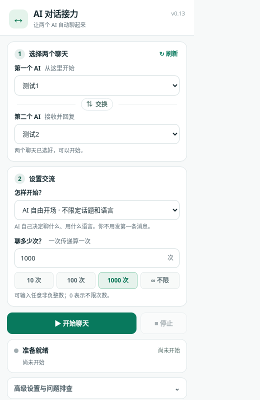

# AI 对话接力 · Two-Chat Relay

**版本：v1.0.0（公开基线版）**

这是一个免费的本地 Chrome 扩展：选择两个已经存在的 ChatGPT 对话，让它们轮流发送回答。无需 OpenAI API 密钥，不使用 n8n 或 Work 模式。

## 能做什么

- 将两个已有的 ChatGPT 标签页设为 A / B，自动交流。
- 支持人工开场、AI 自主开场、完全自由开场（不指定话题与语言）。
- 可选 10、100、1000 次以及不限转发次数（0）。
- 可选不干预长度、自然简洁、严格超长暂停。
- 发送状态不确定时暂停，不自动重复发送。

**支持范围：仅 `chatgpt.com`。** DeepSeek、豆包、Claude 等尚未实现；正在研究 DeepSeek 适配。

## 安装

1. 在 GitHub 仓库点绿色 **Code → Download ZIP**，下载后解压。
2. 用 Chrome 打开 `chrome://extensions`，打开“开发者模式”。
3. 点“加载已解压的扩展程序”，选择解压后包含 `manifest.json` 的目录。
4. 打开两个已存在且各有问答的 ChatGPT 对话，刷新这两个标签页。
5. 点扩展图标，选 A 和 B、选择模式与次数，再点“开始聊天”。

注意：Chrome 需要保持运行、联网。不保证浏览器最小化、标签页被冻结或被丢弃时持续正常运行。扩展与 OpenAI 无隶属关系。自动化读取 ChatGPT 输出涉及相关服务条款限制，请自行审阅适用条款。建议只在专门的非敏感测试聊天里使用。

## 修改记录与后续研究

- [更新记录](CHANGELOG.md)
- [研发日志](docs/DEVELOPMENT_LOG.md)
- [DeepSeek 适配研究](docs/research/deepseek-adapter.md)
- [贡献说明](CONTRIBUTING.md)
- [英文 README](README.md)

许可证：[MIT](LICENSE)。
